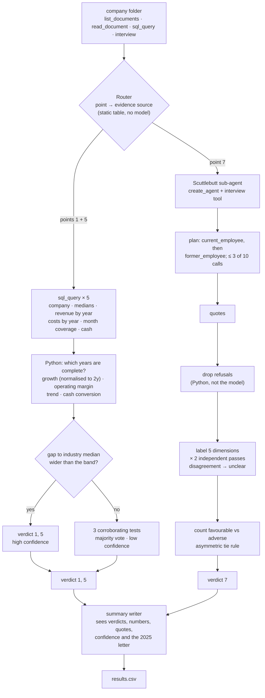

# FTEC5660 Homework 3: Fisher's 15-Point Investment Agent

Build a LangChain agent that researches a company with tools and applies the
framework from Philip Fisher's *Common Stocks and Uncommon Profits* (Part One,
Chapter 3 "What to buy: the fifteen points to look for in a common stock", and
Chapter 4 "What to buy: applying this to your own needs"). You choose 3 of
Fisher's 15 points and decide yourself what PASS means for each. For every
company your agent gives a PASS/FAIL verdict on your 3 points and a short
summary.

The companies are fictional, so the model cannot answer from memory. Unlike a
pile of reports, the evidence is spread over three sources, and your agent has
to go and get it with tools, the way Fisher's "scuttlebutt" method sends an
investor to talk to customers, competitors, suppliers and staff.

## Data and tools

`public_test/` has one folder per company. Your code receives four tools per
company (built by the provided code in `hw3.py`):

| Tool | What it gives you |
| --- | --- |
| `list_documents()` | the company's six documents and their dates |
| `read_document(name)` | one document: the 2025 letter to shareholders, four earnings calls (Q3 2025 to Q2 2026) and a news file (July 2025 to July 2026) |
| `sql_query(query)` | one read-only SQLite query on the company's database; at most 50 rows come back, so use `SUM`, `GROUP BY` and `WHERE` |
| `interview(role, topic)` | what one person says about the company; at most **10 interviews per company** |

The documents are what management says. Management's own claims (such as "we
have never cut research" or "our people are our greatest strength") are not
evidence on their own: check them against the database and the interviews.

**Database tables** (amounts in USD thousands; dates `YYYY-MM-DD`, months
`YYYY-MM`, quarters like `2025Q3`; the fiscal year is the calendar year):

| Table | Columns |
| --- | --- |
| `company` | name, industry |
| `industry_medians` | industry, revenue_growth_2y_pct, new_product_share_pct, new_product_sales_per_rd, operating_margin_pct (one row per industry; use the row for the company's own industry) |
| `orders` | order_id, order_date, product, customer, amount, note (about 3,000 to 4,000 orders from January 2023 to June 2026; revenue is the sum of order amounts) |
| `products` | product, launch_date |
| `monthly_costs` | month, cost_of_sales, selling_admin, research_development |
| `quarterly_cash` | quarter, operating_cash_flow, capex, cash_end |
| `capex_plan` | year, planned_capex (2026 to 2028) |
| `returns` | month, units_shipped, units_returned |
| `insider_trades` | trade_date, person, title, side (`buy` or `sell`), shares, price |

**Terms used in the data.**

| Term | Meaning |
| --- | --- |
| FY2025 | Fiscal year 2025. Here the fiscal year is the calendar year, so FY2025 is January to December 2025. |
| Quarter | Three months of the year: Q1 is January to March, Q2 April to June, Q3 July to September and Q4 October to December. The database writes `2025Q3`; the documents write "third quarter 2025". |
| Amounts | The database is in **USD thousands** (676,100 means US$676.1 million). The documents use USD millions. |
| Revenue | Money from sales: the sum of `amount` in `orders`. |
| Cost of sales | The cost of making the products that were sold. |
| Selling and admin | The cost of selling and of running the company (sales staff, offices, management). |
| R&D | Research and development spending, mainly on new products. |
| Operating margin | Operating profit as a share of revenue: (revenue − cost of sales − selling and admin − R&D) ÷ revenue. |
| Operating cash flow | Cash that the day-to-day business brings in during a quarter. |
| Cash at the end of a quarter | The cash the company holds on the last day of that quarter (`cash_end`). |
| Capex | Capital expenditure: spending on factories, machines and other long-term assets. `capex_plan` holds the planned capex for 2026 to 2028. |
| Return rate | Units returned ÷ units shipped, from the `returns` table. |
| Industry median | The middle value for companies in the same industry, from `industry_medians`. |
| Insider | A director or senior manager of the company. `insider_trades` lists the shares they bought (`buy`) or sold (`sell`). |
| Earnings call | A meeting each quarter where management presents the quarter's results to investors. Each call quotes that quarter's revenue. |

**Interviews.** Roles: `customer`, `current_employee`, `former_employee`,
`competitor`, `supplier`. Topics: `sales_team`, `working_conditions`,
`top_management`, `decision_making`, `competitive_edge`. Only some people know
about each topic; the others say they can't comment, and that answer still
uses up one interview.

| Topic | Who knows about it |
| --- | --- |
| `sales_team` | customer, competitor |
| `working_conditions` | current_employee, former_employee |
| `top_management` | former_employee, supplier |
| `decision_making` | supplier, customer |
| `competitive_edge` | competitor, customer |

People who know about a topic always agree with each other, so one good answer
is enough.

## Choose your 3 points and your rules

Pick any 3 of Fisher's 15 points and write them in `CHOSEN_POINTS` near the
top of `hw3.py`, e.g. `CHOSEN_POINTS = [1, 7, 15]`. The full questions are in
`FISHER_POINTS` in `hw3.py` and in the book.

| # | Fisher's point | Where the evidence is |
| --- | --- | --- |
| 1 | Market potential for sales growth | database |
| 2 | New products as current lines mature | database |
| 3 | Effective research and development | database |
| 4 | Above-average sales organization | interviews (`sales_team`) |
| 5 | Worthwhile profit margin | database |
| 6 | Maintaining or improving margins | database |
| 7 | Labour and personnel relations | interviews (`working_conditions`) |
| 8 | Executive relations | interviews (`top_management`) |
| 9 | Depth of management | interviews (`decision_making`) |
| 10 | Cost analysis and accounting controls | earnings calls, checked against the database |
| 11 | Advantage over competitors | interviews (`competitive_edge`) |
| 12 | Long-range outlook on profits | database |
| 13 | Growth without dilutive equity financing | database |
| 14 | Management talks freely about troubles | earnings calls, checked against the database |
| 15 | Management of unquestionable integrity | news file, checked against the database |

For each of your points, **you design the rule**: which evidence to use, what
to compute or whom to ask, and where the line between PASS and FAIL lies. PASS
means the company looks favourable on that point, as Fisher would see it.

We grade your verdicts against our own answer key. It uses one fixed rule per
point, which we do not publish, and the data never puts a company close to
the line of that rule, so a sensible reading of Fisher usually gives the same
answer. **Test your rules on the public answers**:
`public_test/ground_truth.json` gives the expected verdict on all 15 points
for each of the 20 public companies, and every point fails in 6 of them. If
your rule disagrees with the public answers, rethink it.

**Tip: calculate with tools, not in your head.** Do every sum, ratio and
comparison in SQL or Python, including the number of days between two dates
(SQLite's `julianday()` gives a date as a number of days).

## Student task

Fill in the three places in `hw3.py` marked `### YOUR CODE HERE`. You may add
imports, constants and helper functions above them, but do not change the
provided code below them:

- `CHOSEN_POINTS` lists your 3 points.
- `build_agent()` creates your model and anything else you need once.
- `analyze_companies(agent, companies)` receives
  `{company_folder: [list_documents, read_document, sql_query, interview]}`
  and returns, for every company,
  `{"points": {1: "PASS", 7: "FAIL", 15: "PASS"}, "summary": "..."}` (here with
  `CHOSEN_POINTS = [1, 7, 15]`).

Use the course techniques that fit your points: tool use for the database and
the interviews, planning which interviews to spend, routing each point to the
right source, prompt chaining, parallel calls, reflection to check your
answers, or a combination. Your code must read company data **only through
the four tools**; do not open `company.db` or `interviews.dat` yourself. Do
not hard-code folder names, company names or the public answers.

## Setup and public test

```bash
python3 -m venv .venv
source .venv/bin/activate
pip install -r requirements.txt
echo "DEEPSEEK_API_KEY=your_key_here" > .env
python3 hw3.py --data-folder public_test
```

Use your own DeepSeek API key (from https://platform.deepseek.com). The
required model is `deepseek-v4-flash`. We grade with our own key, so never put
a key in your code; `.env` must stay out of git.

The program creates `results.csv` with the columns `company`, `points`,
`points_correct`, `point_errors`, `interviews_used` and `summary`, and prints
the point score on your 3 points (the percentage after "balanced"). The point
score is the average of two shares: the share of truly passing verdicts that
you marked PASS and the share of truly failing verdicts that you marked FAIL.
For example, 90% and 60% give (90% + 60%) / 2 = 75%, and marking every point
PASS gives (100% + 0%) / 2 = 50%. Once `CHOSEN_POINTS` is set, the starter
runs before you add any API code (it returns no verdicts, so it scores 0%).

`public_test/ground_truth.json` gives the expected verdicts on all 15 points
for each public company. Grading uses a private set of about 20 unseen
companies with the same tools and the same answer key rules, but different
names and wording, and scores your 3 points only.

## Homework 3 solution:

### My 3 points and rules

I chose points **1, 5 and 7**. Together they force the agent to use two different
kinds of evidence — an order book and a cost ledger on one side, an employee's own
words on the other — which is exactly the split Fisher draws between what a
company reports and what the outside world says about it.

All three rules have the same two-layer shape: a **decisive test** that reads the
evidence at face value, and a **corroboration layer** that takes over when the
decisive test is too close to call. That shape is not decoration. A rule whose
verdict changes when the industry median moves by a tenth of a point is not a
rule, it is an accident waiting for a different dataset; my first version was
exactly that, and the audit in Results is what caught it.

| # | Fisher's question (his words) | Why I chose it | My PASS rule | Evidence |
| --- | --- | --- | --- | --- |
| 1 | "Does the company have products or services with sufficient market potential to make possible a sizable increase in sales for at least several years?" | Fisher's first filter: without a long runway of growth nothing else rescues the stock. "Sizable" is meaningless in the abstract, so it is measured against the industry, and against a floor. | **Decisive:** two-year revenue growth (normalised to a two-year rate if the history is shorter) at least **1.5 points above** the industry median. **Within 1.5 points** the ratio is not decisive; the point passes when at least two of three tests agree: growth at or above the median, revenue up in *every* available year, growth above 10% in absolute terms. | `orders` (sum of `amount` by year), `monthly_costs` (month coverage, to know which years are complete), `industry_medians.revenue_growth_2y_pct` |
| 5 | "Does the company have a worthwhile profit margin?" | The word doing the work is "worthwhile". Fisher cares about margins because they pay for growth without new shares and because they reveal pricing power; both are relative to what competitors earn. | **Decisive:** FY2025 operating margin at least **1.0 point above** the industry median. **Within 1.0 point** the point passes when at least two of three tests agree: at or above the median, margin within 0.5 points of where it was in the first year available, operating cash flow at least half of operating profit. | `orders` + `monthly_costs` + `quarterly_cash`, against `industry_medians.operating_margin_pct` |
| 7 | "Does the company have outstanding labor and personnel relations?" | The point that cannot be read off a database. It is Fisher's "scuttlebutt" method: go outside the company and ask the people who work there, because management's "our people are our greatest strength" proves nothing. | Two employee accounts are collected, and each is labelled on five dimensions — pay, tenure, hours, grievances, disputes. **PASS when favourable dimensions clearly outnumber adverse ones; FAIL when adverse ones do not fall short** (any adverse dimension that is not outweighed fails the point, because Fisher asks for *outstanding* relations). Silence on a dimension counts for nothing. | `interview(role, topic="working_conditions")`, roles `current_employee` and `former_employee` (the only two who know this topic) |

The operating margin is the homework's own definition, (revenue − cost of sales −
selling and admin − R&D) ÷ revenue, and the benchmark is the `industry_medians`
row for the company's own industry, as Section 3.2 instructs.

Two design choices are worth stating outright, because they are judgement calls
rather than facts. The 1.5 and 1.0 point bands are wide enough to cover rounding
and definition noise but far narrower than the smallest real gap in the public
set (1.71 points), so they never decide anything there — 0 of 40 decisions on
`public_test` were taken inside a band. The corroboration constants (10% growth
as "sizable", 0.5 points of margin drift as "held", cash conversion of 0.5) are
economic rules of thumb from Fisher's own reasoning, and they only ever act as
tie-breakers.

### Design



The router is a fixed table, not a model call: points 1 and 5 can only be
answered by `sql_query`, point 7 only by `interview`, so letting a model choose
would add cost and risk without adding information. Everything numeric happens
twice removed from the model: the model asks for the data through `sql_query`,
and Python turns the returned rows into a growth rate, an operating margin, a
trend and a cash conversion. The model is not trusted with the comparison either
— it never sees a verdict it could argue with, only the numbers it has to explain.

Points 1 and 5 share one path but not one rule. A year only counts if its cost
ledger covers twelve months, which matters because the last year in every company
is half a year and treating it as a full year invents a collapse in revenue; a
short history is normalised to a two-year rate; and if the company's industry is
missing from `industry_medians` the benchmark falls back to the median across the
published industries, with the substitution recorded and admitted in the summary.
A verdict is only taken on the ratio itself when the company is clearly away from
the median; near the line the rule asks for corroboration instead of splitting
hairs.

Point 7 is the only place where a model touches evidence, and even there it does
not decide. A tool-calling `create_agent` is given the `interview` tool alone and
a plan (ask the current employee, then a former employee, never more than three of
the ten calls), because two independent voices are worth more than one. Python
then drops refusals by pattern rather than by asking the model whether a
non-answer was an answer, and the remaining quotes are labelled on five fixed
dimensions, twice, by two independent passes; a dimension the two passes disagree
on is treated as unclear. The point is then decided by counting, with an
asymmetric tie rule that reflects what Fisher is asking for. The final chained
call writes the two-or-three sentence summary from the verdicts, the ratios, the
quotes, the confidence and the 2025 letter to shareholders, so management's claims
can be set against the numbers rather than repeated; it is explicitly forbidden to
change a verdict. Companies are analysed four at a time with `asyncio.gather` over
`asyncio.to_thread`, each with a 600-second timeout and its own `try/except`, so
one bad API call still leaves a full `results.csv`.

### Results

`python3 hw3.py --data-folder public_test` gives **60/60 correct point verdicts
on the 20 public companies, balanced score 100.0%** (30/30 truly passing points
marked PASS, 30/30 truly failing points marked FAIL), in about **2 minutes**,
using **2 interviews per company out of the ten allowed**. I ran the pipeline
seven times across both versions; the verdicts were identical every time.

There are **no companies where my verdicts disagree with
`public_test/ground_truth.json`**, so there is nothing to explain away. Because a
perfect score on the visible data is exactly the situation in which a student
fools themselves, I audited it instead of trusting it. The scripts are in the repo
and write nothing:

| Check | Script | Result |
| --- | --- | --- |
| `results.csv` is what the code produced, not edited by hand | `verify.py` | recomputes points 1 and 5 from the tools with different SQL (CASE WHEN instead of GROUP BY): **20/20 verdicts reproduced** |
| The answer key is not an absolute cut-off my rule happens to imitate | `verify.py` | **no** fixed growth or margin threshold can separate the 20 answers (0 of 40 candidate cut-offs), so the key must be industry-relative — which is what my rule is |
| Verdicts do not ride on the exact benchmark value | `verify.py` | shifting every industry median by 0.5–3.0 points changes **3** of 240 verdicts in the current rule, against **15** in the single-comparison version it replaced |
| The growth convention does not matter | `verify.py` | writing both sides as a CAGR changes **0/20** verdicts |
| The rule is not knife-edge | `verify.py` | median distance to the line 3.7 points, smallest 1.71 (Kestrel's margin); **40/40** decisions taken outside the confidence bands |
| Point 7 survives rewording, the one thing the private set changes | `test_robust.py` | each real quote rewritten **three** ways (formal HR complaint, casual aside, clipped cautious answer) and re-judged: **60/60** paraphrased verdicts match the key with the five-dimension rule, against **58/60** for the single-question rule it replaced |
| Point 7 spends its interviews sensibly and drops non-answers | `test_robust.py` | with a mock tool where the current employee refuses, the sub-agent still hears the former employee, the refusal is dropped, and the verdict is the right FAIL |
| Odd data does not crash the pipeline | `test_degrade.py` | a two-year history, a missing industry row and a final year with 8 months of costs all produce verdicts, with the substitution recorded |
| One broken company cannot sink the run | `test_errors.py` | a company whose tools all raise still gets an entry and the other company is unaffected |

### What the audit changed

The first version of this agent scored 60/60 as well, and it deserved less credit
than that sounds. Its rule for points 1 and 5 was a single comparison with the
industry median: verdict = growth above the median or not. On the public set that
reproduces the key exactly, which is precisely why it looked finished. Then I
shifted every median by one or two points, the way a different sample of
companies would, and **15 verdicts out of 40 moved** — the answer was riding on
the benchmark, not on the business. The banded rule with corroboration moves 3.

Point 7 changed more fundamentally. The model used to be handed a quote and asked
for PASS or FAIL, with a second call to double-check it; that worked on the public
data, but it made the point depend on a model's opinion of a sentence. It now
labels five concrete dimensions and Python counts them, which means there is no
polarity threshold for a reworded sentence to fall the wrong side of, and the
tie-break is a rule I can state in one line rather than a model's mood. The old
approach still passes the rewording test, so this is not a fix for a failure I
observed — it is a fix for a failure mode I could not rule out.

I also found and fixed a real bug while generalising. The first version hard-coded
FY2023 and FY2025. When I made it pick years from the data instead, growth went
negative for all twenty companies, because the last year in the order book is a
half year (2026 H1) and comparing it with a full year is meaningless. Complete-year
detection by cost-ledger coverage fixed it, and that is the kind of error that only
shows up when you stop assuming the shape of the data.

One correction to an earlier claim of mine. I first reported that measuring
growth over one year instead of two flips 14 of 20 verdicts and that gross margin
flips 6, and called that fragility in the definition. That comparison was
apples-to-oranges: a pre-R&D margin compared with a post-R&D median, a one-year
change compared with a two-year benchmark. Done properly — both sides in the same
convention — the growth convention changes 0 of 20 verdicts. The real fragility
was in the benchmark, not in the definition, and it is measured in the table above.

### Residual risk

Two things I cannot fix from inside this repository. The rules were designed with
the public answers in front of me, which the homework explicitly asks for ("test
your rules on the public answers... if your rule disagrees, rethink it"), so 100%
is an in-sample result: it shows the rule matches the key, not that it generalises.
And point 7 is still the only point that reads language; the dimension scheme
makes it stable across rewording, but a private company whose employee says
something none of the five dimensions covers would be judged on nothing. Both are
reasons the confidence label is printed with every verdict rather than hidden.

## Task 2: Reflection — AI sycophancy and AI psychosis

**Sycophancy is a data problem wearing a personality.** A model trained on human
approval learns that agreement is rewarded, and the failure is quiet: it does not
say "you are right", it says "here is a balanced view" and then quietly adopts
yours. This homework is a controlled experiment in that temptation. Every
company's shareholder letter is written to be agreeable — "our sales team is
second to none", "we have never cut research spending". An agent that reads those
documents and reports what it read will produce confident, well-written,
completely wrong analysis, because the letters are identical in tone for
companies that are failing. The 20 public companies make the cost visible: an
agent that passes everything scores 50% balanced, not 90%, because the metric
deliberately refuses to reward agreement. Sycophancy is not just flattering, it
is uninformative, and a scoring rule that separates the two shares is a cheap
way to make it expensive.

What I had to do to my own agent is the same operation in miniature. The first
version of the reasoning was going to be "ask the model to compare the margin
with the industry median". That is a request for agreement, not a check: given
two numbers and a rule, a model under pressure to be helpful will find a way to
make them consistent, and the homework warns that model arithmetic was its most
common cause of wrong verdicts. So the numbers never enter the model's head. They
are computed in Python from `sql_query` output, and the model is handed the
answer it must explain. The interesting part is that this made the summaries
*better*, not just safer: an agent that has nothing to decide writes more
precisely about what it saw. The same logic applies to the interview: two
independent judgements, the second told explicitly not to defer to the first,
because a reviewer who knows the answer is not a reviewer.

**AI psychosis is what happens when a system's model of the world stops being
corrected by the world.** It is not a single dramatic hallucination; it is a
loop with no exit condition. The agent invents a fact, builds a plan on it,
interprets every new observation as confirmation, and spends its budget
elaborating the mistake. The failure modes are structural, not emotional: no
termination criterion, no external check, unlimited self-reference. Anyone who
has watched an agent burn ten tool calls on a misinterpreted error message has
seen a small version of it.

The homework's design quietly punishes psychosis. There are ten interviews, so
an agent that keeps asking "to be sure" runs out and starts seeing refusals
everywhere; the grader runs three times, so luck does not survive; and the
private set is unseen, so a rule tuned to the public answers collapses. My
defences are deliberately boring: hard caps (three interview calls, 600 seconds
per company), a deterministic core that the model cannot talk itself out of, a
router that is a table rather than an opinion, and a reflection step whose only
job is to disagree once. The 100% score is not evidence that the agent is
intelligent; it is evidence that the loop has an exit.

Where this becomes uncomfortable is that the two failures are the same failure
seen from opposite ends. Sycophancy is the model bending its beliefs toward the
human; psychosis is the model bending its beliefs toward itself. Both are the
same missing term: contact with something that cannot be argued with. In this
homework that thing is `SUM(amount)` — an unglamorous number that does not care
what anyone thinks. The lesson I am taking away is not "use tools", it is that an
agent needs at least one part of its world that is expensive to lie to. A model
allowed to grade its own homework will always pass, and it will be sincere about
it, which is worse.

