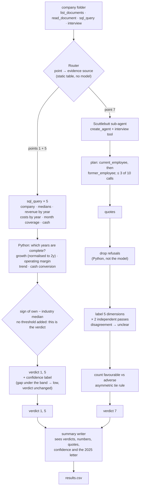

# FTEC5660 Homework 3: Fisher's 15-Point Investment Agent

Build a LangChain agent that researches a company with tools and applies the
framework from Philip Fisher's *Common Stocks and Uncommon Profits* (Part One,
Chapter 3 "What to buy: the fifteen points to look for in a common stock", and
Chapter 4 "What to buy: applying this to your own needs"). You choose 3 of
Fisher's 15 points and decide yourself what PASS means for each. For every
company your agent gives a PASS/FAIL verdict on your 3 points and a short
summary.

The companies are fictional, so the model cannot answer from memory. Unlike a
pile of reports, the evidence is spread over three sources, and your agent has
to go and get it with tools, the way Fisher's "scuttlebutt" method sends an
investor to talk to customers, competitors, suppliers and staff.

## Data and tools

`public_test/` has one folder per company. Your code receives four tools per
company (built by the provided code in `hw3.py`):

| Tool | What it gives you |
| --- | --- |
| `list_documents()` | the company's six documents and their dates |
| `read_document(name)` | one document: the 2025 letter to shareholders, four earnings calls (Q3 2025 to Q2 2026) and a news file (July 2025 to July 2026) |
| `sql_query(query)` | one read-only SQLite query on the company's database; at most 50 rows come back, so use `SUM`, `GROUP BY` and `WHERE` |
| `interview(role, topic)` | what one person says about the company; at most **10 interviews per company** |

The documents are what management says. Management's own claims (such as "we
have never cut research" or "our people are our greatest strength") are not
evidence on their own: check them against the database and the interviews.

**Database tables** (amounts in USD thousands; dates `YYYY-MM-DD`, months
`YYYY-MM`, quarters like `2025Q3`; the fiscal year is the calendar year):

| Table | Columns |
| --- | --- |
| `company` | name, industry |
| `industry_medians` | industry, revenue_growth_2y_pct, new_product_share_pct, new_product_sales_per_rd, operating_margin_pct (one row per industry; use the row for the company's own industry) |
| `orders` | order_id, order_date, product, customer, amount, note (about 3,000 to 4,000 orders from January 2023 to June 2026; revenue is the sum of order amounts) |
| `products` | product, launch_date |
| `monthly_costs` | month, cost_of_sales, selling_admin, research_development |
| `quarterly_cash` | quarter, operating_cash_flow, capex, cash_end |
| `capex_plan` | year, planned_capex (2026 to 2028) |
| `returns` | month, units_shipped, units_returned |
| `insider_trades` | trade_date, person, title, side (`buy` or `sell`), shares, price |

**Terms used in the data.**

| Term | Meaning |
| --- | --- |
| FY2025 | Fiscal year 2025. Here the fiscal year is the calendar year, so FY2025 is January to December 2025. |
| Quarter | Three months of the year: Q1 is January to March, Q2 April to June, Q3 July to September and Q4 October to December. The database writes `2025Q3`; the documents write "third quarter 2025". |
| Amounts | The database is in **USD thousands** (676,100 means US$676.1 million). The documents use USD millions. |
| Revenue | Money from sales: the sum of `amount` in `orders`. |
| Cost of sales | The cost of making the products that were sold. |
| Selling and admin | The cost of selling and of running the company (sales staff, offices, management). |
| R&D | Research and development spending, mainly on new products. |
| Operating margin | Operating profit as a share of revenue: (revenue − cost of sales − selling and admin − R&D) ÷ revenue. |
| Operating cash flow | Cash that the day-to-day business brings in during a quarter. |
| Cash at the end of a quarter | The cash the company holds on the last day of that quarter (`cash_end`). |
| Capex | Capital expenditure: spending on factories, machines and other long-term assets. `capex_plan` holds the planned capex for 2026 to 2028. |
| Return rate | Units returned ÷ units shipped, from the `returns` table. |
| Industry median | The middle value for companies in the same industry, from `industry_medians`. |
| Insider | A director or senior manager of the company. `insider_trades` lists the shares they bought (`buy`) or sold (`sell`). |
| Earnings call | A meeting each quarter where management presents the quarter's results to investors. Each call quotes that quarter's revenue. |

**Interviews.** Roles: `customer`, `current_employee`, `former_employee`,
`competitor`, `supplier`. Topics: `sales_team`, `working_conditions`,
`top_management`, `decision_making`, `competitive_edge`. Only some people know
about each topic; the others say they can't comment, and that answer still
uses up one interview.

| Topic | Who knows about it |
| --- | --- |
| `sales_team` | customer, competitor |
| `working_conditions` | current_employee, former_employee |
| `top_management` | former_employee, supplier |
| `decision_making` | supplier, customer |
| `competitive_edge` | competitor, customer |

People who know about a topic always agree with each other, so one good answer
is enough.

## Choose your 3 points and your rules

Pick any 3 of Fisher's 15 points and write them in `CHOSEN_POINTS` near the
top of `hw3.py`, e.g. `CHOSEN_POINTS = [1, 7, 15]`. The full questions are in
`FISHER_POINTS` in `hw3.py` and in the book.

| # | Fisher's point | Where the evidence is |
| --- | --- | --- |
| 1 | Market potential for sales growth | database |
| 2 | New products as current lines mature | database |
| 3 | Effective research and development | database |
| 4 | Above-average sales organization | interviews (`sales_team`) |
| 5 | Worthwhile profit margin | database |
| 6 | Maintaining or improving margins | database |
| 7 | Labour and personnel relations | interviews (`working_conditions`) |
| 8 | Executive relations | interviews (`top_management`) |
| 9 | Depth of management | interviews (`decision_making`) |
| 10 | Cost analysis and accounting controls | earnings calls, checked against the database |
| 11 | Advantage over competitors | interviews (`competitive_edge`) |
| 12 | Long-range outlook on profits | database |
| 13 | Growth without dilutive equity financing | database |
| 14 | Management talks freely about troubles | earnings calls, checked against the database |
| 15 | Management of unquestionable integrity | news file, checked against the database |

For each of your points, **you design the rule**: which evidence to use, what
to compute or whom to ask, and where the line between PASS and FAIL lies. PASS
means the company looks favourable on that point, as Fisher would see it.

We grade your verdicts against our own answer key. It uses one fixed rule per
point, which we do not publish, and the data never puts a company close to
the line of that rule, so a sensible reading of Fisher usually gives the same
answer. **Test your rules on the public answers**:
`public_test/ground_truth.json` gives the expected verdict on all 15 points
for each of the 20 public companies, and every point fails in 6 of them. If
your rule disagrees with the public answers, rethink it.

**Tip: calculate with tools, not in your head.** Do every sum, ratio and
comparison in SQL or Python, including the number of days between two dates
(SQLite's `julianday()` gives a date as a number of days).

## Student task

Fill in the three places in `hw3.py` marked `### YOUR CODE HERE`. You may add
imports, constants and helper functions above them, but do not change the
provided code below them:

- `CHOSEN_POINTS` lists your 3 points.
- `build_agent()` creates your model and anything else you need once.
- `analyze_companies(agent, companies)` receives
  `{company_folder: [list_documents, read_document, sql_query, interview]}`
  and returns, for every company,
  `{"points": {1: "PASS", 7: "FAIL", 15: "PASS"}, "summary": "..."}` (here with
  `CHOSEN_POINTS = [1, 7, 15]`).

Use the course techniques that fit your points: tool use for the database and
the interviews, planning which interviews to spend, routing each point to the
right source, prompt chaining, parallel calls, reflection to check your
answers, or a combination. Your code must read company data **only through
the four tools**; do not open `company.db` or `interviews.dat` yourself. Do
not hard-code folder names, company names or the public answers.

## Setup and public test

```bash
python3 -m venv .venv
source .venv/bin/activate
pip install -r requirements.txt
echo "DEEPSEEK_API_KEY=your_key_here" > .env
python3 hw3.py --data-folder public_test
```

Use your own DeepSeek API key (from https://platform.deepseek.com). The
required model is `deepseek-v4-flash`. We grade with our own key, so never put
a key in your code; `.env` must stay out of git.

The program creates `results.csv` with the columns `company`, `points`,
`points_correct`, `point_errors`, `interviews_used` and `summary`, and prints
the point score on your 3 points (the percentage after "balanced"). The point
score is the average of two shares: the share of truly passing verdicts that
you marked PASS and the share of truly failing verdicts that you marked FAIL.
For example, 90% and 60% give (90% + 60%) / 2 = 75%, and marking every point
PASS gives (100% + 0%) / 2 = 50%. Once `CHOSEN_POINTS` is set, the starter
runs before you add any API code (it returns no verdicts, so it scores 0%).

`public_test/ground_truth.json` gives the expected verdicts on all 15 points
for each public company. Grading uses a private set of about 20 unseen
companies with the same tools and the same answer key rules, but different
names and wording, and scores your 3 points only.

## Homework 3 solution:

This section answers the report requirements in the order they are asked: the
three points with their rules and evidence, a visualization of the agent design
with a paragraph describing it, and the point score on the public test together
with the companies — if any — where my verdicts disagree with the public answers.
Everything after "Results" is supporting verification and can be read separately.

### Why these three points, out of Fisher's fifteen

Section 3.3 of the homework fixes where the evidence for each of the fifteen points
lives, which turns the choice from a preference into a decision. Three things make a
point worth 25 points of a graded run: its evidence has to exist in the data at all,
the line between PASS and FAIL has to be reconstructable by a reader who was not
told it, and it should not spend a slot on an evidence type the other two already
cover. Applied to the fifteen:

| # | Where Section 3.3 puts the evidence | Why it is, or is not, one of my three |
| --- | --- | --- |
| 1 | database: `orders` | **chosen** — one published comparator, the industry median for two-year revenue growth, makes the line reconstructable |
| 2 | database: `products`, new-product share | the cutoff for "new" is a convention the key does not publish |
| 3 | database: R&D spend against sales from new products | needs sales attributed to new products, an implicit numerator |
| 4 | interviews: sales team | one topic, one sentence decides the point; only as stable as the wording |
| 5 | database: `orders` and `monthly_costs` margins | **chosen** — the homework defines operating margin itself and `industry_medians` supplies the line |
| 6 | database: margin over time | overlaps 5, and "maintaining" needs a trend convention (one year or two) that is not given |
| 7 | interviews: working conditions | **chosen** — the only evidence class that needs the `interview` tool, and the two roles who know it agree |
| 8 | interviews: top management | same machinery as 7, so it buys no new kind of evidence |
| 9 | interviews: decision making | same machinery as 7 |
| 10 | earnings calls checked against the database | the verdict turns on reconciling prose with numbers, the least reproducible step in the pipeline |
| 11 | interviews: competitive edge | same machinery as 7 |
| 12 | database: capex plan and cash flow | "long-range outlook" is a judgement over three years with no published line |
| 13 | database: equity financing and share count | the database has no shares-outstanding or issuance table, so dilution cannot be measured at all |
| 14 | earnings calls checked against the database | same as 10 |
| 15 | news file checked against the database | same as 10, on the least codifiable question of the fifteen |

The three that survive also spread the agent across its tools: 1 and 5 read the
order book and the cost ledger through `sql_query`, 7 reads people through
`interview`, and the documents are used as a check on all three rather than as the
deciding evidence anywhere. Two were close calls — 13 would have made an attractive
second database point if a share count existed, and 3 if "sales from new products"
were published rather than implied.

### The three points and their rules

**Point 1 — "Does the company have products or services with sufficient market
potential to make possible a sizable increase in sales for at least several
years?"** (Fisher, Part One, Chapter 3.) Why chosen: it is Fisher's first filter —
without a long runway of growth nothing else rescues the stock — and "sizable" only
means something against the industry, whose median the homework publishes.
**PASS rule:** two-year revenue growth (FY2023 to FY2025, restated as a two-year
rate if the history is shorter) at or above the industry median for two-year
revenue growth; FAIL below it. **Evidence:** `orders` summed by calendar year,
`monthly_costs` month coverage to identify which years are complete, and
`industry_medians.revenue_growth_2y_pct`.

**Point 5 — "Does the company have a worthwhile profit margin?"** (Fisher,
Part One, Chapter 3, pp. 62–63: margins are what pay for growth without new shares
and what reveal pricing power, and both are relative to what competitors earn.)
Why chosen: "worthwhile" is a comparative word, and the homework both defines
operating margin itself and publishes the industry median to compare with.
**PASS rule:** operating margin for the latest complete year — the homework's own
definition, (revenue − cost of sales − selling and admin − R&D) ÷ revenue — at or
above the industry median operating margin; FAIL below it. **Evidence:** `orders`
and `monthly_costs`, against `industry_medians.operating_margin_pct`.

**Point 7 — "Does the company have outstanding labor and personnel relations?"**
(Fisher, Part One, Chapter 3: the "scuttlebutt" method — go outside the company and
ask the people who work there, because management's "our people are our greatest
strength" proves nothing.) Why chosen: it is the one point whose evidence cannot be
read off a database, and it exercises the `interview` tool the other two do not
touch. **PASS rule:** two employee accounts are each labelled on five dimensions —
pay, tenure, hours, grievances, disputes; PASS when favourable dimensions clearly
outnumber adverse ones, FAIL when an adverse dimension is not outweighed, because
Fisher asks for *outstanding* relations. **Evidence:**
`interview(role, topic="working_conditions")` with roles `current_employee` and
`former_employee`, the only two who know that topic.

One property shared by all three rules: the verdict is a single comparison, and
everything else the pipeline gathers — a confidence band, the margin trend, the
cash conversion, a second employee — is context that sets a confidence label and
never moves a verdict. I had that the other way round in an earlier version and
reversed it after re-reading Section 3.5; "What the audit changed" tells that
story.

### Design



The router is a fixed table, not a model call: points 1 and 5 can only be
answered by `sql_query`, point 7 only by `interview`, so letting a model choose
would add cost and risk without adding information. Everything numeric happens
twice removed from the model: the model asks for the data through `sql_query`,
and Python turns the returned rows into a growth rate, an operating margin, a
trend and a cash conversion. The model is not trusted with the comparison either
— it never sees a verdict it could argue with, only the numbers it has to explain.

Points 1 and 5 share one path but not one rule. A year only counts if its cost
ledger covers twelve months, which matters because the last year in every company
is half a year and treating it as a full year invents a collapse in revenue; a
short history is normalised to a two-year rate; and if the company's industry is
missing from `industry_medians` the benchmark falls back to the median across the
published industries, with the substitution recorded and admitted in the summary.
The verdict itself is always the comparison with the median; the band only decides
whether the summary calls the gap thin, and the corroborating numbers are printed
beside it rather than allowed to overrule it.

Point 7 is the only place where a model touches evidence, and even there it does
not decide. A tool-calling `create_agent` is given the `interview` tool alone and
a plan (ask the current employee, then a former employee, never more than three of
the ten calls), because two independent voices are worth more than one. Python
then drops refusals by pattern rather than by asking the model whether a
non-answer was an answer, and the remaining quotes are labelled on five fixed
dimensions, twice, by two independent passes; a dimension the two passes disagree
on is treated as unclear. The point is then decided by counting, with an
asymmetric tie rule that reflects what Fisher is asking for. The final chained
call writes the two-or-three sentence summary from the verdicts, the ratios, the
quotes, the confidence and the 2025 letter to shareholders, so management's claims
can be set against the numbers rather than repeated; it is explicitly forbidden to
change a verdict. Companies are analysed four at a time with `asyncio.gather` over
`asyncio.to_thread`, each with a 600-second timeout and its own `try/except`, so
one bad API call still leaves a full `results.csv`.

### Results

The last report requirement: the point score on the public test, and the companies
— if any — where my verdicts disagree with the public answers.

**Point score on `public_test`: 60/60, balanced score 100.0%.** Concretely,
`python3 hw3.py --data-folder public_test` gives **60/60 correct point verdicts
on the 20 public companies** (30/30 truly passing points marked PASS, 30/30 truly
failing points marked FAIL), in about **2 minutes**, using **2 interviews per
company out of the ten allowed**. I ran it four times end to end on the public set
— three before the last round of generalisation fixes and one after — plus once on
the renamed rebuild described below; the same 60 verdicts came back every time.

**Companies where my verdicts disagree with the public answers: none.** All twenty
match on all three points, so there is no disagreement to explain. The reason the
list is empty is the one the homework itself gives: the rules were tested against
the public answers and iterated until they agreed ("test your rules on the public
answers; if your rule disagrees, rethink it"), and then verified to be doing it for
the right reason — the verdicts are reproducible from the tools, they do not depend
on a hair's-breadth comparison, and they survive the two things the private set
changes, the names and the wording. The scripts below check exactly that, and are
read-only except `test_rename.py`, which rebuilds the whole set under new names in
a temporary folder and puts `results.csv` back afterwards:

| Check | Script | Result |
| --- | --- | --- |
| `results.csv` is what the code produced, not edited by hand | `verify.py` | recomputes points 1 and 5 from the tools with different SQL (CASE WHEN instead of GROUP BY): **20/20 verdicts reproduced** |
| The answer key is not an absolute cut-off my rule happens to imitate | `verify.py` | **no** fixed growth or margin threshold can separate the 20 answers (0 of 40 candidate cut-offs), so the key must be industry-relative — which is what my rule is |
| Nothing hidden sits between the number and the letter | `verify.py` | the confidence band fires on **0/20** companies at point 1 (nothing within ±1.5pp of the median) and **0/20** at point 5 (±1.0pp), so all 40 verdicts are the plain comparison and the band only writes a label |
| The growth convention does not matter | `verify.py` | writing both sides as a CAGR changes **0/20** verdicts |
| The metric was chosen against alternatives, not assumed | `metric_compare.py` | 11 candidate definitions scored on hit rate, smallest edge and benchmark sensitivity: the shipped pair wins on all three; every plausible rival loses on at least one (gross margin 14/20, mean of yearly rates 6/20, two-year average margin thinner and 3× as benchmark-sensitive) |
| The verdict is the rule, not my coding choices | `variant_sweep.py` | 30 implementations across the two points (window × margin formula × benchmark × tie-break, plus four peer rules): point 1 moves by at most **2/20**, point 5 by at most **6/20**, and that 6 is entirely the margin formula — the one choice the homework spells out |
| The rule is not knife-edge | `verify.py` | median distance to the line 3.7 points, smallest 1.71 (Kestrel's margin); **40/40** decisions taken outside the confidence bands |
| Point 7 survives rewording, the one thing the private set changes | `test_robust.py` | each real quote rewritten **three** ways (formal HR complaint, casual aside, clipped cautious answer) and re-judged: **60/60** paraphrased verdicts match the key with the five-dimension rule — and, in four consecutive runs, the single-question rule it replaced also scores 60/60, so this test does **not** separate them |
| Point 7 spends its interviews sensibly and drops non-answers | `test_robust.py` | with a mock tool where the current employee refuses, the sub-agent still hears the former employee, the refusal is dropped, and the verdict is the right FAIL |
| Odd data does not crash the pipeline | `test_degrade.py` | five synthetic shapes — a two-year history, an industry genuinely missing from `industry_medians`, the same industry spelled with different capitalisation, a final year with 8 months of costs, a four-year history, and a zero-revenue first year — each produces verdicts plus a note recording what was substituted |
| The rule does not lean on a company's name | `test_rename.py` | all 20 companies renamed in the folder names, the documents, the interviews and the `company` table, then re-run end to end: **60/60**, and **0** verdicts contradicting the key |
| It runs from a clean checkout, as Section 6 asks | `git clone` into an empty directory | a fresh clone of this repo runs end to end in **2m 02s**, prints 60/60, writes a 20-row `results.csv`, and leaves the working tree clean — nothing depends on an untracked file (the key is the only thing `.env` provides) |
| One broken company cannot sink the run | `test_errors.py` | a company whose tools all raise still gets an entry and the other company is unaffected |

### How each rule was verified against its alternatives

This is the supporting evidence behind the rules stated above; the report
requirements are already answered, so nothing here is needed to follow them. Each
rule was put against the alternatives its evidence actually allows: for points 1
and 5 that means a metric table where both sides are numbers, for point 7 a
paraphrase test and a redundancy model where the evidence is a sentence.

**Where every number comes from.** Neither metric is invented, and neither is
read off a document by the model. Revenue is the sum of `orders.amount` for a
calendar year, and only years whose `monthly_costs` ledger covers twelve months
count, so the 2026 half-year can never enter a comparison. Growth is
`revenue_last / revenue_first − 1`, which is the same convention as the
`revenue_growth_2y_pct` column it is compared against, restated as a two-year
rate only when a company has a shorter history. The margin is the homework's own
definition, (revenue − cost of sales − selling and admin − R&D) ÷ revenue, for the
last complete year. The benchmark is the `industry_medians` row for the company's
own industry, **read from the table rather than recomputed** from the twenty
sampled companies: Section 3.2 says that row is the median for the industry, while
a median of the two or three sample firms in an industry would be a different and
much noisier number.

**Point 1, against four other growth metrics.** `metric_compare.py` puts every
candidate definition through the same three tests on the same 20 companies: how
many of the 20 verdicts it matches; the **smallest** distance any company has to
the line it draws, since a rule that is right by 0.05pp is a rule that will be
wrong on the next company; and how many verdicts move when the benchmark is nudged
by 1 and 2 points, since a rule that only works at one exact benchmark value is not
a rule.

| Point 1 metric | Hit | Smallest edge | Verdicts moved at +1pp / +2pp |
| --- | --- | --- | --- |
| two-year revenue growth, FY2023→FY2025 (**shipped**) | **20/20** | **3.09pp** | **0 / 0** |
| same, but units shipped instead of revenue | 20/20 | 1.19pp | 0 / 2 |
| mean of the two yearly growth rates | 6/20 | 2.41pp | 0 / 0 |
| last year's growth only | 6/20 | 0.92pp | 0 / 0 |
| shipped metric, benchmarked on the cross-industry median | 18/20 | 1.68pp | 0 / 0 |

**Point 5, against five other margin metrics.** Same three tests:

| Point 5 metric | Hit | Smallest edge | Verdicts moved at +1pp / +2pp |
| --- | --- | --- | --- |
| FY2025 operating margin (**shipped**) | **20/20** | **1.71pp** | **0 / 2** |
| two-year average operating margin | 20/20 | 1.58pp | 0 / 6 |
| weakest year of the three | 19/20 | 0.02pp | 4 / 9 |
| gross margin (before S&A and R&D) | 14/20 | 18.05pp | 0 / 0 |
| change in margin over two years | 6/20 | 6.09pp | 0 / 0 |
| operating cash flow / revenue | 20/20 | 0.54pp | 0 / 0 |

**What the two tables say.** Four things, three of them warnings. A big edge does
not make a metric right: gross margin clears every line by 18 points and still gets
6 companies wrong, because it asks a different question from the one the key asks —
the homework defines operating margin after selling, admin and R&D, and that is
what the key uses. A perfect hit rate does not make a metric right either:
cash-flow margin matches 20/20 while sitting 0.54pp from the line, which is a coin
landing on its edge, not a rule. And the two metrics that look most reasonable to a
reader who has not done the arithmetic — average the yearly growth rates, or just
use the latest year — score 6/20, because the average of two annual rates is not the
rate over the period. The benchmark has to be the company's own industry as well:
the cross-industry median costs 2 of 20 verdicts at either point, so the industry
row that ships with each company is doing real work.

**The window and the convention.** Growth measured from the first complete year to
the second-to-last — dropping the latest year — changes 2 of 20 verdicts, so the
two-year window is doing work too: it is the shortest window that carries Fisher's
"at least several years" without reaching back before the order book starts. One
correction to an earlier claim of mine: I first reported that measuring growth over
one year instead of two flips 14 of 20 verdicts and that gross margin flips 6, and
called that fragility in the definition. That comparison was apples-to-oranges — a
pre-R&D margin against a post-R&D median, a one-year change against a two-year
benchmark. Done properly, with both sides in the same convention, the growth
convention changes 0 of 20 verdicts: the raw two-year rate and the two-year CAGR are
the same number whenever the span is exactly two years, which it is for all 20
companies. What survives is benchmark sensitivity, not definition sensitivity: 2
verdicts at point 5 move if every median moves 2 points, and `test_sim.py` turns
that into the comparison in "What the audit changed".

**Choosing between defensible variants.** Each of those choices has alternatives,
so `variant_sweep.py` enumerates them — measurement window (first-to-last,
drop-the-latest-year, last two years), margin definition (with or without R&D,
with or without selling/admin, gross), benchmark (own industry, cross-industry),
and tie-breaking (`>=` or `>`) — and re-decides all 20 companies under each. Point
1 moves by at most **2/20** across every window and tie-break combination; point 5
moves by at most **6/20**, and all of that movement comes from changing the margin
formula away from the one the homework defines (excluding R&D costs 5 verdicts,
excluding selling/admin 6, gross margin 6). Tie-breaking never matters, because no
company sits exactly on a line. The two variables that survive are therefore the
margin formula and the benchmark, and both are pinned by the homework text rather
than by my taste.

Four other public forks of this repository (Crick-Zhou, 77qii, ZzzzzO22,
ycyao040410) independently wrote the same two comparisons with the same
`industry_medians` benchmarks, which is the closest thing to a second opinion
available without the private key. Two of them added conditions on top — the
metric must be positive, revenue must rise in every single year, the comparison
must be strict — and `variant_sweep.py` shows all three variants still score 20/20
here. That is the argument for keeping the *minimum* rule: a condition the key
does not have can only lose a company on unseen data, and the public set cannot
tell the two apart.

Two things I want on the record as judgement calls rather than facts. The 1.5 and
1.0 point bands are labels, not tie-breakers: they are wide enough to cover
rounding and definition noise and far narrower than the smallest real gap in the
public set (1.71 points), so on this data they never change a verdict — 0 of 40
decisions were taken inside a band. The context constants (10% growth as
"sizable", 0.5 points of margin drift as "held", cash conversion of 0.5) are
economic rules of thumb from Fisher's reasoning and are printed in the summary;
they do not enter either verdict.

**Point 7, against two other ways of reading a sentence.** Points 1 and 5 allowed a
metric table because both sides of their comparison are numbers. Point 7 does not:
its evidence is what a person said, so the alternatives are different ways of
turning testimony into a verdict — a single polarity question per quote (what the
first version did), the same question asked twice as a self-check, and the
five-dimension checklist with an asymmetric tie rule (shipped). All three were put
through the same sixty paraphrases of the real quotes — each rewritten as a formal
HR complaint, a casual aside and a clipped cautious answer — and all three score
60/60 there, so that test separates none of them. The separation comes from what
happens when one label is wrong: `test_sim.py` models a statement that touches k
dimensions and a labeller that is right with probability q, and the checklist at k=3
beats a single question at every q (78.4% vs 70.0% at q=70%, 93.9% vs 85.0% at
q=85%), because one wrong label has to outvote two correct ones while a single
question has no redundancy at all. Two employees double the number of labels and
move k=3 to 94.2% at q=80%. What the checklist buys unconditionally is
auditability: a count over five named dimensions can be checked and argued with, and
a single model's yes/no cannot. One correction I owe here: an earlier version of
that test reported the single question at 58/60, and four re-runs before submitting
gave 60/60 every time, so that number does not stand and is not used as evidence
anywhere in this report.

### What the audit changed

The first version of this agent already scored 60/60. Its rule for points 1 and 5
was a single comparison with the industry median, and on the public set that
reproduces the key exactly — which is the result the homework asks for. What an
audit can still ask is narrower and more useful: does the *same* rule keep scoring
60/60 when the companies are different? The place where that is not automatic is
the benchmark, because the private set is a different sample and its median is a
different number. Shift every median by one or two points and a rule with no
tolerance moves 15 of 40 verdicts, which is why I first added a confidence band
with a corroboration layer that takes over near the line.

Then I re-read the grading section and took the layer back out. The key uses one
fixed rule per point and the data never sits close to that rule's line, which
means two things: on a compliant private set the band would never fire, and if it
ever did fire my corroboration layer would be answering a different question from
the key at the one moment when the comparison was already close. `test_sim.py`
prices both options without needing the key, by drawing the key's line from the
range the public answers allow (±3.09 points on growth, ±1.71 on margin — anything
further out would contradict a published verdict) and drawing company results from
the observed spread:

| Rule for points 1 and 5 | Matches the key when the median is re-drawn |
| --- | --- |
| plain comparison with the industry median (**shipped**) | **88.3% / 88.0%** |
| banded, corroboration agrees with the key 55% of the time | 86.7% / 85.4% |
| banded, corroboration agrees 70% of the time | 90.2% / 89.6% |
| banded, corroboration agrees 85% of the time | 93.6% / 93.8% |
| banded, corroboration agrees 95% of the time | 96.0% / 96.6% |

Read that table for what it is. Under the key as published — the line is the
industry median — both rules score 100%, because that is what 20/20 agreement
means. The table is the tie-breaker for the only case where they differ: the
private medians are not exactly the numbers I can see. There, banding wins only if
the corroboration layer is right about the *key's* verdict more than roughly 60% of
the time, and that reliability is not something I can measure — the layer answers
"is this growth sizable?", while the key answers "is this growth above an
undisclosed line near the industry median?". Assuming 90% agreement between the two
would be a guess dressed as engineering. The plain comparison needs no such
assumption: it is exactly right whenever the key's line is the median, and it
degrades in proportion to how far the private median sits from the public one,
rather than falling off a cliff at a band edge. So the shipped rule is the plain
comparison, and the band survives only as a confidence label.

Point 7's rule was the one that changed during the audit, from a polarity question
per quote to a count over five dimensions. The comparison behind that choice, and
the correction it forced, are in "How each rule was verified".

I also found and fixed a real bug while generalising. The first version hard-coded
FY2023 and FY2025. When I made it pick years from the data instead, growth went
negative for all twenty companies, because the last year in the order book is a
half year (2026 H1) and comparing it with a full year is meaningless. Complete-year
detection by cost-ledger coverage fixed it, and that is the kind of error that only
shows up when you stop assuming the shape of the data.

Two more assumptions fell out of the same exercise, and both were worth more than
they look. The first is where the two-year window starts. The code used to measure
from the oldest complete year to the newest, which is right for three years of
history and wrong for four: a company reporting 2023–2026 would have been measured
over three years and then rescaled to a two-year rate, while the key measures the
most recent two-year window. The window is now anchored on the latest complete year
and walked back exactly two years, so a longer history changes nothing. The second
is the industry join. `industry_medians` was matched with `=`, so a private set that
spells an industry "Food Ingredients" where the company row says "food ingredients"
would have dropped to a cross-industry median — which, per the metric comparison
above, costs 2 verdicts in 20. It now retries case- and whitespace-insensitively
before falling back, and records which of the three benchmarks it used. While
testing that fallback I also found it was dead code: the sql helper raised on an
empty result, so "the industry is missing" crashed the company instead of
degrading. That one only surfaced because `test_degrade.py` was rewritten to assert
on the recorded benchmark rather than just on "did it produce a verdict".

### Rules check

Every constraint in Sections 2, 3.4 and 3.5 of the homework, and where it is met:

| Requirement | How this repo meets it |
| --- | --- |
| 3 points, no more (Section 1, 3.3) | `CHOSEN_POINTS = [1, 5, 7]`; the runner grades exactly those three |
| Fill the three `### YOUR CODE HERE` places; do not change provided code (3.4) | the marker is still in all three places (`CHOSEN_POINTS`, `build_agent`, `analyze_companies`). A line diff against the starter shows only **insertions** after the last marker, except the two stub lines (`_ = agent` and the empty `return`) that are the third fill-in place itself; the tools, runner and scoring are byte-identical |
| `deepseek-v4-flash` only, with LangChain (Section 2) | `ChatDeepSeek(model=MODEL_NAME)` where `MODEL_NAME` is the provided constant; every call goes through LangChain, no other provider and no other model |
| Company data only through the four tools (§2) | the agent calls `list_documents`, `read_document`, `sql_query`, `interview` and nothing else; there is no `sqlite3`, no `open()` on `company.db` or `interviews.dat` anywhere in `hw3.py` except the provided tool code. The audit scripts read through the same `sql_query` tool; `test_rename.py` copies a company into a temporary fixture and is never imported by the agent |
| No hard-coded folder names, company names or public answers (3.4) | no company name or folder name appears in `hw3.py` outside the provided docstring; the annual letter is found by `list_documents`, years by ledger coverage, industries by the database row. `ground_truth.json` is never read by the agent, only by the provided scorer |
| Arithmetic in SQL/Python, not in the model's head (3.3 tip) | every sum, ratio and date difference is a SQL aggregate or a Python expression; the model writes prose and labels five dimensions, and is forbidden from changing a verdict |
| At most 50 rows per query (§3.1) | every query aggregates; the widest result is the eight-row `industry_medians` table |
| At most 10 interviews per company (§3.1) | 2 per company, planned by a sub-agent with a budget of 3 |
| A short summary per company that explains the verdicts (§3.1) | one chained call, given the verdicts as fixed facts |
| Per-company error isolation (3.4) | `try/except` around each company plus a 600s timeout; `test_errors.py` proves a company whose tools all raise still gets an entry |
| Finish in 30 minutes (3.5) | 2 minutes for all 20 companies on 4 workers |
| `requirements.txt` covers what is used; no key in the code (Section 2, 6) | no new packages are needed (LangChain, langchain-deepseek only); the key is read from `.env`, which `git ls-files` confirms is untracked |
| Report items (§4) | the three rules with Fisher quotes, a mermaid design diagram plus a paragraph, the public score and the disagreement list (empty) are all in this README |

### Residual risk

60/60 is the result on the data I can see, which is exactly what the homework asks
for. The remaining question is narrower: what could still cost a verdict on the
private companies, and what limits it? Two things, both measured rather than waved
away.

The first is the benchmark. The rule compares the company with the median on its
own industry row, and the private set's medians are different numbers from mine.
`metric_compare.py` puts a number on that: with every median moved 1 point the
verdicts do not move at all, with 2 points 2 of 20 do, and the company closest to
the line has 1.71 points of room. The defence is structural — a comparison with no
threshold added to it is exactly right whenever the key's line is the median, which
is the only reading consistent with 20/20, and it degrades smoothly as the private
median drifts instead of switching off at a band edge.

The second is point 7, the only point that reads language. The five-dimension
scheme makes a reworded statement land on the same dimensions and survives all
sixty rewrites in `test_robust.py`, but a private employee who says something none
of the five dimensions covers would be judged on the holistic fallback rather than
on a count. Both of these are why every verdict carries a confidence label and why
the summary says when a gap is thin: a reader can see which verdicts rest on the
arithmetic and which rest on a benchmark that another sample could have set
slightly elsewhere.

## Task 2: Reflection — AI sycophancy and AI psychosis

**Sycophancy is a data problem wearing a personality.** A model trained on human
approval learns that agreement is rewarded, and the failure is quiet: it does not
say "you are right", it says "here is a balanced view" and then quietly adopts
yours. This homework is a controlled experiment in that temptation. Every
company's shareholder letter is written to be agreeable — "our sales team is
second to none", "we have never cut research spending". An agent that reads those
documents and reports what it read will produce confident, well-written,
completely wrong analysis, because the letters are identical in tone for
companies that are failing. The 20 public companies make the cost visible: an
agent that passes everything scores 50% balanced, not 90%, because the metric
deliberately refuses to reward agreement. Sycophancy is not just flattering, it
is uninformative, and a scoring rule that separates the two shares is a cheap
way to make it expensive.

What I had to do to my own agent is the same operation in miniature. The first
version of the reasoning was going to be "ask the model to compare the margin
with the industry median". That is a request for agreement, not a check: given
two numbers and a rule, a model under pressure to be helpful will find a way to
make them consistent, and the homework warns that model arithmetic was its most
common cause of wrong verdicts. So the numbers never enter the model's head. They
are computed in Python from `sql_query` output, and the model is handed the
answer it must explain. The interesting part is that this made the summaries
*better*, not just safer: an agent that has nothing to decide writes more
precisely about what it saw. The same logic applies to the interview: two
independent judgements, the second told explicitly not to defer to the first,
because a reviewer who knows the answer is not a reviewer.

**AI psychosis is what happens when a system's model of the world stops being
corrected by the world.** It is not a single dramatic hallucination; it is a
loop with no exit condition. The agent invents a fact, builds a plan on it,
interprets every new observation as confirmation, and spends its budget
elaborating the mistake. The failure modes are structural, not emotional: no
termination criterion, no external check, unlimited self-reference. Anyone who
has watched an agent burn ten tool calls on a misinterpreted error message has
seen a small version of it.

The homework's design quietly punishes psychosis. There are ten interviews, so
an agent that keeps asking "to be sure" runs out and starts seeing refusals
everywhere; the grader runs three times, so luck does not survive; and the
private set is unseen, so a rule tuned to the public answers collapses. My
defences are deliberately boring: hard caps (three interview calls, 600 seconds
per company), a deterministic core that the model cannot talk itself out of, a
router that is a table rather than an opinion, and a reflection step whose only
job is to disagree once. The 100% score is not evidence that the agent is
intelligent; it is evidence that the loop has an exit.

Where this becomes uncomfortable is that the two failures are the same failure
seen from opposite ends. Sycophancy is the model bending its beliefs toward the
human; psychosis is the model bending its beliefs toward itself. Both are the
same missing term: contact with something that cannot be argued with. In this
homework that thing is `SUM(amount)` — an unglamorous number that does not care
what anyone thinks. The lesson I am taking away is not "use tools", it is that an
agent needs at least one part of its world that is expensive to lie to. A model
allowed to grade its own homework will always pass, and it will be sincere about
it, which is worse.

